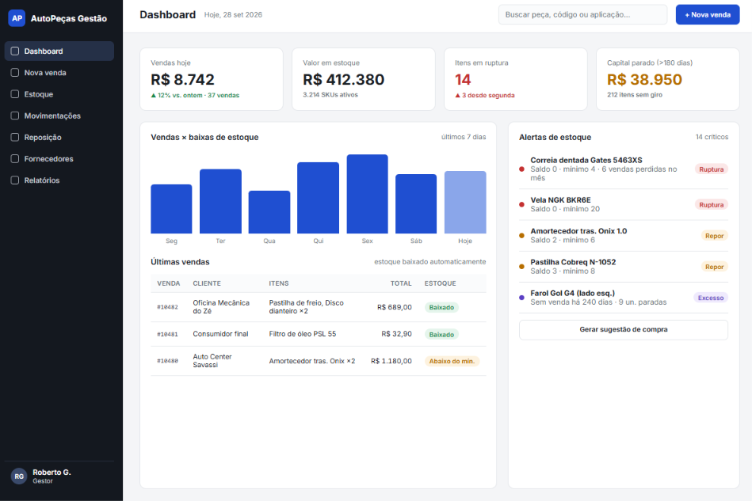
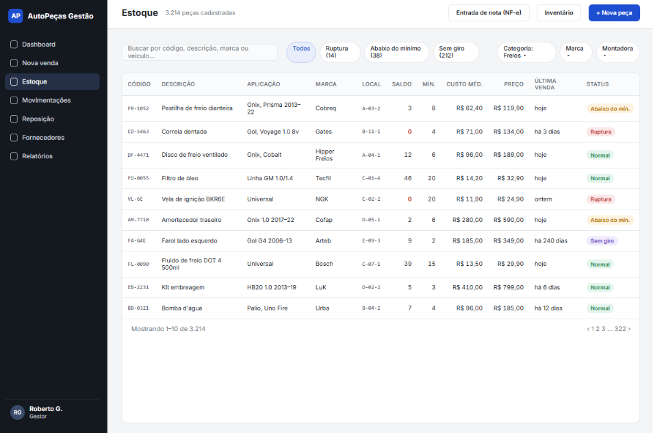
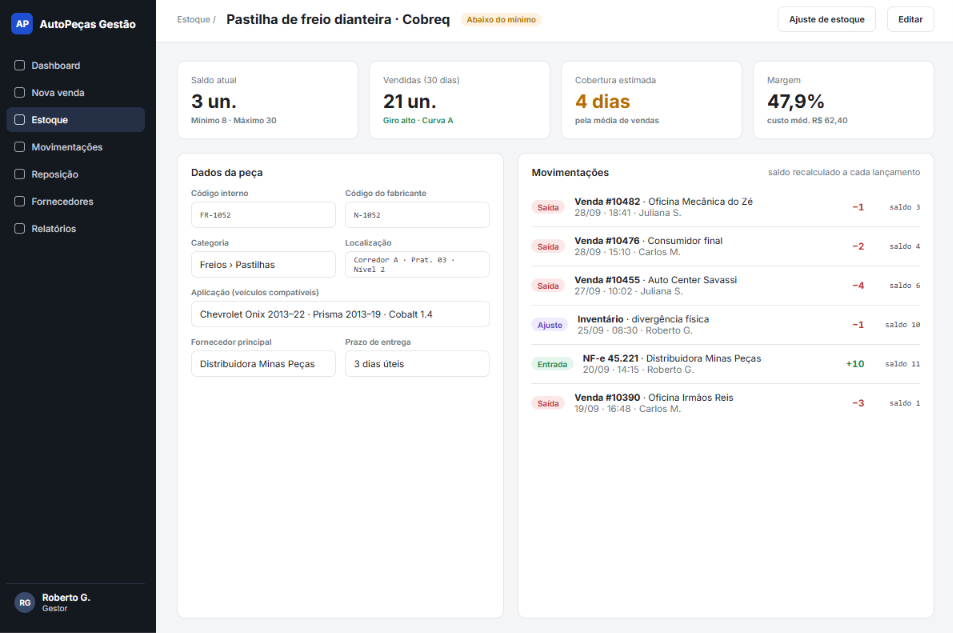
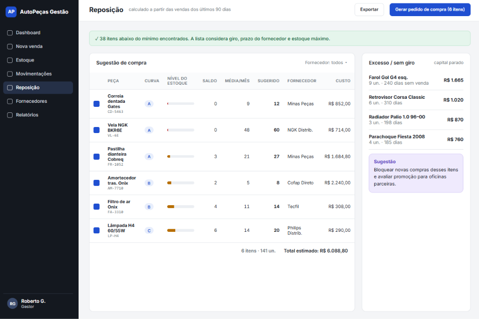
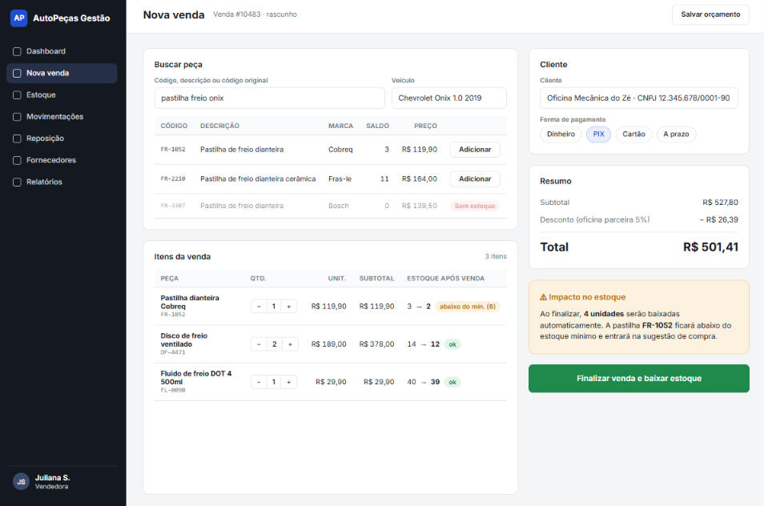

# Sistema Integrado de Gestão Empresarial (SIGE) — Comércio de Autopeças

> Projeto desenvolvido para a disciplina **Trabalho Interdisciplinar: Sistemas Integrados de Gestão Empresarial (TI: SIGE)** — Curso de Sistemas de Informação.

---

## Sumário

- [Sobre o Projeto](#sobre-o-projeto)
- [Objetivos do Sistema](#objetivos-do-sistema)
- [Processos de Negócio Cobertos](#processos-de-negócio-cobertos-bpmn--visão-erp)
- [Tecnologias Utilizadas](#tecnologias-utilizadas)
- [Como Executar o Projeto](#como-executar-o-projeto)
- [Estrutura do Repositório](#estrutura-do-repositório)
- [Documentação](#documentação)
- [Requisitos do Sistema](#requisitos-do-sistema)
- [Protótipos de Tela](#protótipos-de-tela)
- [Status do Projeto](#status-do-projeto)
- [Professor Orientador](#professor-orientador)
- [Integrantes da Equipe](#integrantes-da-equipe)
- [Licença](#licença)

---

## Sobre o Projeto

O setor de varejo de autopeças lida com alta diversidade de itens e rápida obsolescência, o que torna o controle manual ou descentralizado (planilhas isoladas, controle em papel etc.) altamente propenso a divergências entre o estoque físico e o saldo registrado no sistema.

Esse descompasso gera dois problemas recorrentes na operação:

- **Ruptura de estoque** — o cliente procura um item que, na prática, não está disponível;
- **Excesso de mercadorias paradas** — capital imobilizado em produtos sem giro.

Este projeto propõe uma aplicação de gestão empresarial com foco na **integração direta entre os processos de Vendas e Controle de Estoque**, automatizando baixas, reservas e atualizações em tempo real, de forma a reduzir divergências e oferecer aos gestores uma visão única e confiável da operação.

---

## Objetivos do Sistema

- **Integração Vendas ↔ Estoque** — baixa e reserva automática de peças no fechamento de pedidos de venda, eliminando a atualização manual do saldo.
- **Centralização de Dados** — substituição de planilhas isoladas por uma base única, garantindo visão unificada das operações.
- **Controle Operacional** — histórico de movimentações de estoque, alertas de nível crítico e suporte à tomada de decisão de compras e reposição.

---

## Processos de Negócio Cobertos (BPMN / Visão ERP)

| Processo | Descrição |
|---|---|
| **Gestão de Catálogo e Estoque** | Cadastro de componentes, compatibilidade entre peças e controle do saldo físico. |
| **Processamento de Vendas** | Emissão de pedidos, conferência de disponibilidade em tempo real e baixa automática de saldo. |
| **Aquisição e Reposição** | Registro de entrada de insumos com atualização automática do almoxarifado. |

---

## Tecnologias Utilizadas

| Camada | Tecnologia |
|---|---|
| **Backend** | *.Net / C#* |
| **Frontend** | *HTML/CSS/JS* |
| **Banco de Dados** | *MySQL* |
| **Modelagem de Processos** | Camunda / Bizagi (BPMN) |

---

## Como Executar o Projeto

### Pré-requisitos

- [Git](https://git-scm.com/)
- [.NET SDK](https://dotnet.microsoft.com/download)

### Passo a passo

1. Clone o repositório:
   ```bash
   git clone https://github.com/Leonardo-Leonhardt/erp-autopecas-sige.git
   ```

2. Acesse a pasta da aplicação:
   ```bash
   cd erp-autopecas-sige/src/AutoPecas.Api
   ```

3. Inicie a aplicação (o `dotnet run` já restaura as dependências):
   ```bash
   dotnet run
   ```

4. Abra **http://localhost:5080** no navegador.

Sem configuração, a aplicação usa um **banco em memória** com dados de demonstração (catálogo do protótipo e ~90 dias de histórico de vendas). Os dados são recriados a cada execução.

Para usar o **MySQL**, informe a string de conexão em `src/AutoPecas.Api/appsettings.json` (ou na variável de ambiente `ConnectionStrings__MySql`):

```json
"ConnectionStrings": {
  "MySql": "Server=localhost;Database=autopecas;User=root;Password=suasenha;"
}
```

As tabelas são criadas automaticamente na primeira execução (`EnsureCreated`) e os dados de demonstração só são inseridos se o banco estiver vazio.

---

## Estrutura do Repositório

```
erp-autopecas-sige/
├── docs/
│   ├── artigo/       # Texto do artigo
│   │   └── TI Sistemas Integrados de Gestão Empresarial.pdf
│   └── diagramas/    # Diagramas UML, BPMN e casos de uso [a fazer]
│   └── imagens/      # Imagens do projeto
├── prototipo/
│   └── prototipo-estoque-autopecas.html  # Protótipo estático original das telas
├── src/
│   └── AutoPecas.Api/    # Aplicação (.NET 8 Minimal API + frontend em wwwroot/)
├── tests/            # Testes automatizados
└── README.md
```

---

## Documentação

O texto do trabalho acadêmico estará disponível em [`docs/artigo/TI_SIGE.pdf`](docs/artigo/TI_SIGE.pdf).

Diagramas UML, BPMN e casos de uso ficarão em [`docs/diagramas/`](docs/diagramas/). [a fazer]

---

## Requisitos do Sistema

A especificação de requisitos define os serviços e funcionalidades que o sistema deve fornecer, bem como as restrições sob as quais ele deve operar (SOMMERVILLE, 2019). Para o desenvolvimento do sistema integrado de gestão de estoque e vendas, os requisitos foram classificados em **Requisitos Funcionais (RF)** e **Requisitos Não Funcionais (RNF)**, acompanhados de suas respectivas prioridades (**Essencial, Importante e Desejável**).

### Requisitos Funcionais (RF)

Os requisitos funcionais descrevem os comportamentos, fluxos de dados, operações e regras de negócio esperadas do software (PRESSMAN; MAXIM, 2021).

| Identificador | Nome do Requisito | Descrição Detalhada | Prioridade |
|---|---|---|---|
| RF01 | Autenticação e Gestão de Acessos | O sistema deve permitir login seguro com perfis diferenciados (ex.: Administrador/Gerente e Vendedor/Operador de Caixa), restringindo o acesso a telas e operações sensíveis de acordo com as permissões. | Essencial |
| RF02 | Gerenciamento de Produtos | O sistema deve permitir cadastrar, consultar, atualizar e inativar produtos, contemplando campos como código/SKU, descrição, fabricante, categoria, preço de custo, preço de venda, estoque mínimo e localização no almoxarifado. | Essencial |
| RF03 | Movimentação Manual de Estoque | O sistema deve disponibilizar funcionalidade para registrar entradas avulsas (compras/reposição), saídas (perdas/descartes) e ajustes manuais decorrentes de inventário físico, exigindo justificativa e identificação do responsável. | Essencial |
| RF04 | Reserva Temporária de Peças | Durante o processo de montagem do pedido de venda, o sistema deve reservar temporariamente as unidades selecionadas, impedindo conflitos de vendas simultâneas ou faturamento de itens indisponíveis. | Importante |
| RF05 | Realização e Conclusão de Vendas | O sistema deve registrar pedidos de venda com cálculo automático de subtotal, descontos e total líquido, solicitando a forma de pagamento e os dados do cliente. | Essencial |
| RF06 | Baixa Automática de Estoque | Ao concluir/faturar a venda, o sistema deve debitar imediatamente as quantidades correspondentes no saldo de estoque disponível, garantindo a consistência das informações. | Essencial |
| RF07 | Cancelamento de Venda e Devolução | O sistema deve permitir o cancelamento de pedidos e o registro de devoluções, realizando automaticamente o estorno dos itens ao estoque e registrando a justificativa da operação. | Importante |
| RF08 | Alerta de Estoque Crítico | O sistema deve monitorar os saldos e emitir alertas visuais na interface caso o volume em estoque de determinado produto atinja ou fique abaixo do nível de estoque mínimo configurado. | Importante |
| RF09 | Histórico e Rastreabilidade | O sistema deve manter um registro cronológico (trilha de auditoria) de todas as movimentações de estoque e transações de venda, identificando data, hora, usuário, tipo de operação e variação de saldo. | Essencial |
| RF10 | Relatórios e Dashboards Gerenciais | O sistema deve gerar relatórios e indicadores consolidados de vendas por período, produtos com maior giro, produtos com baixa rotatividade e posição valorizada do estoque. | Importante |
| RF11 | Cadastro de Clientes e Fornecedores | O sistema deve permitir o cadastro e consulta de clientes e fornecedores com identificação documental (CPF/CNPJ), dados para contato e endereço. | Desejável |

### Requisitos Não Funcionais (RNF)

Os requisitos não funcionais definem atributos de qualidade, aspectos arquiteturais, desempenho, conformidade legal e restrições operacionais que o sistema deve cumprir (SOMMERVILLE, 2019).

| Identificador | Categoria | Descrição Detalhada | Prioridade |
|---|---|---|---|
| RNF01 | Plataforma / Arquitetura | O sistema deve ser desenvolvido como uma aplicação web responsiva, acessível pelos principais navegadores modernos (Google Chrome, Mozilla Firefox, Microsoft Edge e Safari), sem dependência de instalação local no cliente. | Essencial |
| RNF02 | Persistência e Integridade | O sistema deve centralizar suas informações em um Sistema Gerenciador de Banco de Dados Relacional (SGBD-R), garantindo propriedades ACID (Atomicidade, Consistência, Isolamento e Durabilidade) para evitar duplicidade ou divergência nas baixas e reservas de itens. | Essencial |
| RNF03 | Segurança | As senhas dos usuários devem ser armazenadas de forma criptografada (utilizando algoritmos de hash como bcrypt/Argon2) e o tráfego de dados entre cliente e servidor deve operar obrigatoriamente sobre o protocolo seguro HTTPS (TLS 1.2 ou superior). | Essencial |
| RNF04 | Desempenho | Consultas à disponibilidade de estoque e inserção de itens no carrinho devem retornar resposta ao usuário em tempo inferior a 2 (dois) segundos sob condições normais de uso da rede interna. | Importante |
| RNF05 | Usabilidade | A interface gráfica do usuário deve ser intuitiva, priorizando atalhos rápidos e clareza visual para permitir que operadores realizem uma consulta de disponibilidade ou finalização de venda em poucos cliques. | Importante |
| RNF06 | Disponibilidade | O sistema deve manter taxa de disponibilidade mínima de 99% durante o horário comercial de funcionamento da loja, reduzindo o risco de paradas no caixa ou no balcão de vendas. | Importante |
| RNF07 | Manutenibilidade | A arquitetura de software deve ser modular, separando adequadamente as camadas de apresentação (front-end), regras de negócio/serviços (back-end) e acesso a dados, facilitando manutenções corretivas e evolutivas. | Importante |
| RNF08 | Conformidade Legal | O tratamento e armazenamento dos dados de clientes e colaboradores devem estar em conformidade com as diretrizes da Lei Geral de Proteção de Dados Pessoais (LGPD — Lei nº 13.709/2018). | Desejável |

### Referências Bibliográficas

- PRESSMAN, Roger S.; MAXIM, Bruce R. *Engenharia de Software: uma abordagem profissional*. 9. ed. Porto Alegre: AMGH, 2021.
- SOMMERVILLE, Ian. *Engenharia de Software*. 10. ed. São Paulo: Pearson Education do Brasil, 2019.

---

## Protótipos de Tela

| Dashboard | Estoque | Produto |
|---|---|---|
|  |  |  |

| Reposição | Vendas |
|---|---|
|  |  | 

---

## Status do Projeto

Em desenvolvimento.

---

## Professor Orientador

- Paulo Augusto Isnard Santos

---

## Integrantes da Equipe

- Arthur Vinícius Reis Rodrigues
- Emanuela Vitória Magalhães Alves
- Fantine de Fatima Bonfim
- Giovanna Ribeiro Santos
- Kayk da Silva Souza
- Leonardo Leonhardt Bispo
- Rodrigo Fernandes Ribeiro Pinto
- Yanne Assis Alves

---

## Licença

*Uso exclusivo acadêmico*
